<!--
  Profile README for github.com/TheSangamX.
  The images in profile/svg are rebuilt every morning from sangamgupta.in by scripts/build_profile.py
  (.github/workflows/sync-site.yml), in the site's own fonts and colours, light and dark.
  Edit profile/config.json for the intro, featured projects and the Ask Sangam example; edit facts on the site.
-->

<p align="center">
<a href="https://www.sangamgupta.in"><picture><source media="(prefers-color-scheme: dark)" srcset="https://raw.githubusercontent.com/TheSangamX/TheSangamX/main/profile/svg/header-dark.svg"></picture></a>
</p>

<p align="center">
<a href="https://www.sangamgupta.in/?ask=What%20has%20Sangam%20built%20on%20his%20own%3F"><picture><source media="(prefers-color-scheme: dark)" srcset="https://raw.githubusercontent.com/TheSangamX/TheSangamX/main/profile/svg/link-ask-sangam-dark.svg"></picture></a> <a href="https://www.sangamgupta.in"><picture><source media="(prefers-color-scheme: dark)" srcset="https://raw.githubusercontent.com/TheSangamX/TheSangamX/main/profile/svg/link-portfolio-dark.svg"></picture></a> <a href="https://www.sangamgupta.in/resume"><picture><source media="(prefers-color-scheme: dark)" srcset="https://raw.githubusercontent.com/TheSangamX/TheSangamX/main/profile/svg/link-resume-dark.svg"></picture></a> <a href="https://www.linkedin.com/in/thesangamx"><picture><source media="(prefers-color-scheme: dark)" srcset="https://raw.githubusercontent.com/TheSangamX/TheSangamX/main/profile/svg/link-linkedin-dark.svg"></picture></a> <a href="mailto:contact@sangamgupta.in"><picture><source media="(prefers-color-scheme: dark)" srcset="https://raw.githubusercontent.com/TheSangamX/TheSangamX/main/profile/svg/link-email-dark.svg"></picture></a> <a href="https://x.com/TheSangamX"><picture><source media="(prefers-color-scheme: dark)" srcset="https://raw.githubusercontent.com/TheSangamX/TheSangamX/main/profile/svg/link-x-dark.svg"></picture></a>
</p>

<br>

<a href="https://www.sangamgupta.in/?ask=What%20has%20Sangam%20built%20on%20his%20own%3F"><picture><source media="(prefers-color-scheme: dark)" srcset="https://raw.githubusercontent.com/TheSangamX/TheSangamX/main/profile/svg/ask-dark.svg">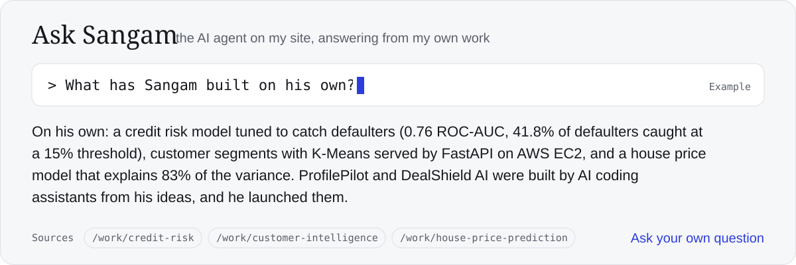</picture></a>

<a href="https://www.sangamgupta.in/work"><picture><source media="(prefers-color-scheme: dark)" srcset="https://raw.githubusercontent.com/TheSangamX/TheSangamX/main/profile/svg/numbers-dark.svg">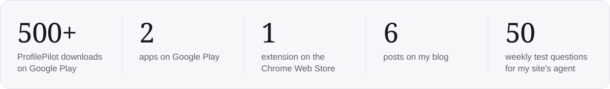</picture></a>

## Selected work

The first five are my own machine-learning work; where AI helped with an app around the model, the card says so. The last three I shipped with AI coding assistants: the idea and the launch are mine, the code is theirs.

<!-- PROJECTS:START -->
<p>
<a href="https://www.sangamgupta.in/work/credit-risk"><picture><source media="(prefers-color-scheme: dark)" srcset="https://raw.githubusercontent.com/TheSangamX/TheSangamX/main/profile/svg/project-credit-risk-dark.svg">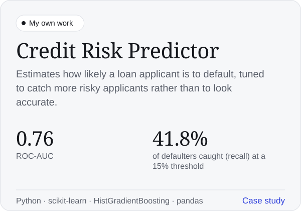</picture></a>
<a href="https://www.sangamgupta.in/work/house-price-prediction"><picture><source media="(prefers-color-scheme: dark)" srcset="https://raw.githubusercontent.com/TheSangamX/TheSangamX/main/profile/svg/project-house-price-prediction-dark.svg">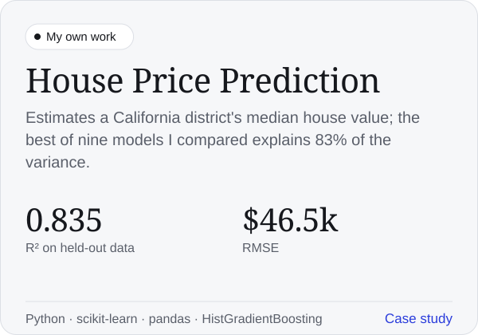</picture></a>
</p>
<p>
<a href="https://www.sangamgupta.in/work/customer-intelligence"><picture><source media="(prefers-color-scheme: dark)" srcset="https://raw.githubusercontent.com/TheSangamX/TheSangamX/main/profile/svg/project-customer-intelligence-dark.svg">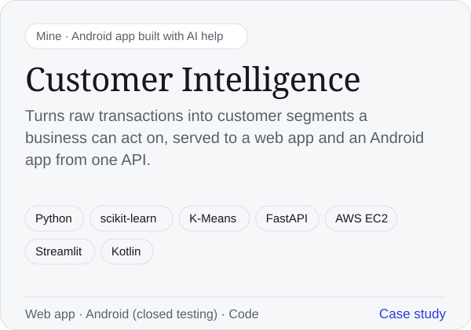</picture></a>
<a href="https://www.sangamgupta.in/work/newsintel"><picture><source media="(prefers-color-scheme: dark)" srcset="https://raw.githubusercontent.com/TheSangamX/TheSangamX/main/profile/svg/project-newsintel-dark.svg">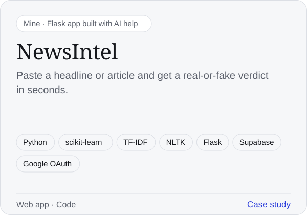</picture></a>
</p>
<p>
<a href="https://www.sangamgupta.in/work/student-marks"><picture><source media="(prefers-color-scheme: dark)" srcset="https://raw.githubusercontent.com/TheSangamX/TheSangamX/main/profile/svg/project-student-marks-dark.svg">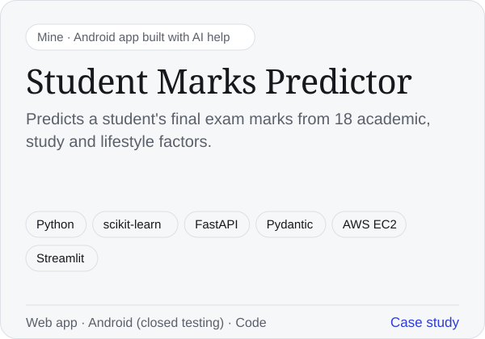</picture></a>
<a href="https://www.sangamgupta.in/work/profilepilot"><picture><source media="(prefers-color-scheme: dark)" srcset="https://raw.githubusercontent.com/TheSangamX/TheSangamX/main/profile/svg/project-profilepilot-dark.svg">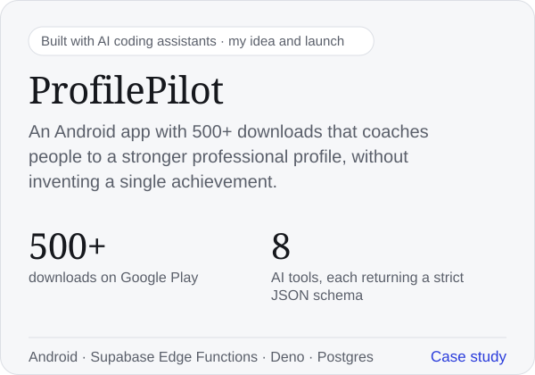</picture></a>
</p>
<p>
<a href="https://www.sangamgupta.in/work/dealshield-ai"><picture><source media="(prefers-color-scheme: dark)" srcset="https://raw.githubusercontent.com/TheSangamX/TheSangamX/main/profile/svg/project-dealshield-ai-dark.svg">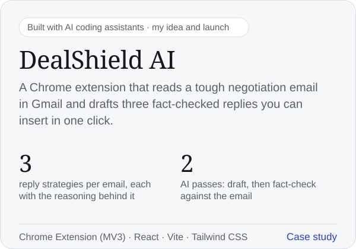</picture></a>
<a href="https://www.sangamgupta.in/work/sangamgupta-in"><picture><source media="(prefers-color-scheme: dark)" srcset="https://raw.githubusercontent.com/TheSangamX/TheSangamX/main/profile/svg/project-sangamgupta-in-dark.svg">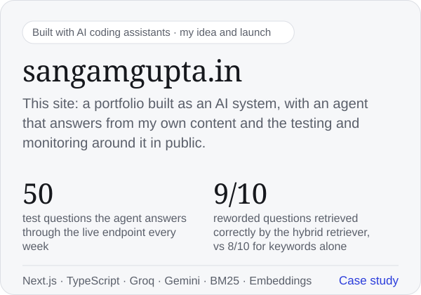</picture></a>
</p>
<!-- PROJECTS:END -->

<p align="center"><a href="https://www.sangamgupta.in/work"><b>Every project, with demos you can run in the browser</b></a></p>

## What I work with

<picture><source media="(prefers-color-scheme: dark)" srcset="https://raw.githubusercontent.com/TheSangamX/TheSangamX/main/profile/svg/toolkit-dark.svg">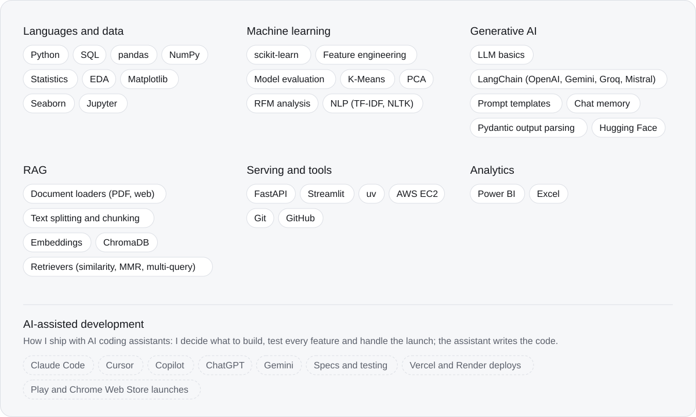</picture>

<!-- LEARNING:START -->
**Learning now:** Prompt engineering, Deep learning.
<!-- LEARNING:END -->

## Latest writing

<!-- WRITING:START -->
**[One K-Means model, two apps: serving it from FastAPI on EC2](https://www.sangamgupta.in/writing/one-kmeans-model-two-apps)** <sub>2026-11-23</sub><br>
My customer segmentation model answers a Streamlit web app and an Android app from one small FastAPI service on AWS EC2. Here's what the service does, and what it doesn't do yet.

**[Nine regression models, one split: what my comparison can and can't say](https://www.sangamgupta.in/writing/nine-regression-models-one-split)** <sub>2026-11-16</sub><br>
I trained nine scikit-learn regressors on the California housing data. The winner was clear, but some of the gaps in my table say more about default settings than about the algorithms.

**[Why I picked the clustering model with the lower score](https://www.sangamgupta.in/writing/why-i-picked-the-clustering-model-with-the-lower-score)** <sub>2026-11-13</sub><br>
DBSCAN beat K-Means on silhouette score in my customer segmentation project. It also put 98% of customers in one group. Here's how I chose.
<!-- WRITING:END -->

[All posts on sangamgupta.in](https://www.sangamgupta.in/writing) · also on [DEV](https://dev.to/thesangamx) · [RSS](https://www.sangamgupta.in/feed.xml)

## Connect your AI to my portfolio

My site runs an MCP server, so Claude, ChatGPT, Cursor or any MCP client can read my projects, skills and writing and check them against a job description.

```json
{
  "mcpServers": {
    "sangamgupta": { "url": "https://www.sangamgupta.in/mcp" }
  }
}
```

How it works and a live tester: [sangamgupta.in/connect](https://www.sangamgupta.in/connect)

## Activity

<picture><source media="(prefers-color-scheme: dark)" srcset="https://raw.githubusercontent.com/TheSangamX/TheSangamX/output/snake-dark.svg"></picture>

<br>

<p align="center">
<picture><source media="(prefers-color-scheme: dark)" srcset="https://raw.githubusercontent.com/TheSangamX/TheSangamX/main/profile/svg/footer-dark.svg"></picture>
</p>
