<!--
  GitHub Profile README
  Repository name must exactly match your GitHub username: TheSangamX
-->

<div align="center">


<br/>

<a href="https://sangamgupta.in">
  
</a>
<a href="https://linkedin.com/in/thesangamx">
  
</a>
<a href="mailto:contact@sangamgupta.in">
  
</a>
<a href="https://github.com/TheSangamX">
  
</a>
<a href="https://x.com/TheSangamX">
  
</a>

<br/><br/>


<br/><br/>

[](https://sangamgupta.in/work/profilepilot)
[](#featured-projects)
[](https://sangamgupta.in/work/dealshield-ai)
[](https://sangamgupta.in)

</div>

---

<div align="center">

```text
┌─────────────────────────────────────────────────────────────────────────────┐
│  ENGINEERING PATH                                                           │
│                                                                             │
│  DATA  →  MODEL  →  API  →  APPLICATION  →  CLOUD  →  PRODUCTION            │
└─────────────────────────────────────────────────────────────────────────────┘
```

</div>

# `$ whoami`

I'm an **ML engineer** (Computer Engineering, 2026). My hands-on work is data science and classic machine learning in Python: pandas, scikit-learn, model evaluation, and serving models with FastAPI and Streamlit.

I also ship AI products with AI coding assistants. For ProfilePilot, DealShield AI and my site, the idea and the launch are mine and the assistant wrote the code. I'm learning RAG, LLM APIs and deep learning so I can build that layer myself.

I am interested in the complete engineering path around a model—not only training it, but understanding how it can be served, connected to applications, deployed, and improved.

> **The direction:** `Data → Model → API → Application → Deployment → Iteration`

```yaml
identity:
  name: Sangam Gupta
  role: ML Engineer / Data Scientist
  background: Computer Engineering graduate (2026)
  based_in: Mumbai, India

focus:
  - Machine Learning & applied Data Science
  - Model evaluation and feature engineering
  - Model serving with FastAPI and Streamlit
  - API-driven applications
  - Cloud deployment with AWS EC2
  - Algorithmic trading & quantitative finance
  - Shipping AI products with AI coding assistants

currently_learning:
  - Prompt engineering, RAG and LLM APIs
  - DevOps
  - Cloud Infrastructure
  - Deep Learning

philosophy: "Depth over breadth — real projects over endless tutorials."
```

<br/>

### `> What I'm actively building toward`

```text
✓ Understand ML beyond model.fit()
✓ Serve models through production-style APIs
✓ Connect one backend to multiple clients
✓ Learn deployment and infrastructure
✓ Strengthen SQL, statistics and ML fundamentals
✓ Build systems that people can actually use
```

---

# `$ tree engineering/`

```text
engineering/
│
├── machine-learning/
│   ├── data-analysis/
│   ├── model-training/
│   └── evaluation/
│
├── backend/
│   ├── FastAPI/
│   ├── Flask/
│   └── REST-APIs/
│
├── applications/
│   ├── Streamlit/
│   └── Android / Jetpack Compose/
│
└── deployment/
    ├── AWS EC2/
    ├── Cloud/
    └── Production workflows/
```

---

# `$ ./tech-stack.sh`

<div align="center">

### ◈ LANGUAGES & CORE


<br/><br/>

### ◈ MACHINE LEARNING & DATA


<br/><br/>

### ◈ BACKEND, APIs & APPLICATIONS


<br/><br/>

### ◈ DATA, CLOUD & TOOLS


</div>

---

<a id="featured-projects"></a>

# `$ ls -la featured-projects/`

> **Not notebooks left behind after training. These are projects built around the model, the interface, and the delivery layer.**

<table>
<tr>

<td width="50%" valign="top">

## 🧭 ProfilePilot

**AN AI PROFILE COACH WITH 500+ DOWNLOADS ON GOOGLE PLAY.**

*Built with AI coding assistants: my idea and launch, the assistant's code.*

An Android app that coaches people to a stronger professional profile without inventing a single achievement.

- 📱 500+ downloads on Google Play
- 🧠 8 AI tools, each returning a strict JSON schema
- 🔒 No data collected, per the Play Store data safety listing

`Android` · `Supabase Edge Functions` · `Deno` · `Postgres` · `Groq`

### [Case study](https://sangamgupta.in/work/profilepilot) · [Google Play](https://play.google.com/store/apps/details?id=in.sangamgupta.linkedinoptimizer)

</td>

<td width="50%" valign="top">

## 🛡️ DealShield AI

**A NEGOTIATION COPILOT FOR GMAIL, ON THE CHROME WEB STORE.**

*Built with Claude Code: my idea and launch, the assistant's code.*

Reads a tough negotiation email and drafts three fact-checked replies you can insert in one click.

- ✉️ 3 reply strategies per email, each with its reasoning
- ✅ 2 AI passes: draft, then fact-check against the email
- 💳 Accounts and a paid plan (Supabase + Razorpay)

`Chrome MV3` · `React` · `Express` · `Zod` · `Groq` · `Supabase`

### [Case study](https://sangamgupta.in/work/dealshield-ai) · [Code](https://github.com/TheSangamX/dealshield-ai)

</td>

</tr>
<tr>

<td width="50%" valign="top">

## 🤖 sangamgupta.in

**MY PORTFOLIO, BUILT AS AN AI SYSTEM.**

*Built with Claude Code: I decide what goes on it, the assistant writes the code.*

An agent that answers questions about my work from the site's own content, with the engineering around it in public.

- 🔎 Hybrid retrieval (BM25 + embeddings, fused by RRF)
- 🔁 Groq → Gemini → offline fallback, with live telemetry
- 🧪 Weekly evals, red-team page, drift monitoring, MCP server

`Next.js` · `TypeScript` · `Groq` · `Gemini` · `Upstash Redis` · `Vercel`

### [Case study](https://sangamgupta.in/work/sangamgupta-in) · [Live](https://sangamgupta.in)

</td>

<td width="50%" valign="top">

<a id="credit-risk-predictor"></a>

## 💳 Credit Risk Predictor

**TUNED TO CATCH RISKY APPLICANTS, NOT TO LOOK ACCURATE.**

`HistGradientBoostingClassifier` with a 15% decision threshold and a per-applicant explanation.

- 📈 0.76 ROC-AUC
- 🎯 41.8% of defaulters caught at the 15% threshold
- 🤗 Runs free on Hugging Face, same results as the original model

`Python` · `scikit-learn` · `pandas` · `Streamlit`

### [Case study](https://sangamgupta.in/work/credit-risk) · [Try it](https://huggingface.co/spaces/TheSangamX/credit-risk-predictor) · [Code](https://github.com/TheSangamX/credit_risk_predictor)

</td>

</tr>
<tr>

<td width="50%" valign="top">

## 📰 NewsIntel

**FAKE-NEWS DETECTION WITH A FULL APPLICATION LAYER.**

*The ML model is my work; the Flask web app was built with AI help.*

TF-IDF and a Passive Aggressive Classifier behind Google sign-in and a saved verification history.

- 🌐 Deployed web app on its own domain
- 🔐 Google Authentication
- 🗄️ Supabase Postgres verification history

`Python` · `Flask` · `NLP` · `scikit-learn` · `Supabase`

### [Case study](https://sangamgupta.in/work/newsintel) · [Code](https://github.com/TheSangamX/NewsIntel)

</td>

<td width="50%" valign="top">

## 👥 Customer Intelligence

**ONE MODEL, SERVED TO WEB AND ANDROID FROM ONE API.**

*Data work, model, API and AWS deployment are mine; the Android app was built with AI help.*

Turns raw transactions into customer segments a business can act on.

- 🧮 RFM features + K-Means segmentation
- ⚙️ FastAPI on AWS EC2
- 📱 Streamlit web app and a Kotlin Android client

`Python` · `scikit-learn` · `FastAPI` · `AWS EC2` · `Kotlin`

### [Case study](https://sangamgupta.in/work/customer-intelligence) · [Code](https://github.com/TheSangamX/customer-intelligence-segmentation)

</td>

</tr>
</table>

<div align="center">

**All projects, with demos you can run in the browser: [sangamgupta.in/work](https://sangamgupta.in/work)**

</div>

<br/>

## `Project Delivery Matrix`

| Project | ML / Core | Backend | Interface | Deployment |
|---|---|---|---|---|
| 🧭 ProfilePilot | LLM (gpt-oss-120b on Groq), JSON schemas | Supabase Edge Functions | Android | Google Play |
| 🛡️ DealShield AI | LLM draft + fact-check passes | Node.js + Express | Chrome extension | Chrome Web Store + Render |
| 🤖 sangamgupta.in | Hybrid RAG agent, evals | Next.js API routes | Web | Vercel |
| 💳 Credit Risk Predictor | HistGradientBoostingClassifier | — | Streamlit + static web | Hugging Face |
| 📰 NewsIntel | TF-IDF + Passive Aggressive Classifier | Flask | Web app | Own domain |
| 👥 Customer Intelligence | K-Means | FastAPI | Streamlit + Android | AWS EC2 |

<div align="center">

> **The goal is simple: learn the model, understand the engineering around it, and ship something usable.**

</div>

---

# `$ cat engineering-philosophy.md`

```text
I am especially interested in the part after:

    model.fit()

How does the model get served?
How does an application communicate with it?
Where does user data go?
How is the service deployed?
How can the same backend support multiple clients?

That is the direction I am actively exploring:

ML → APIs → Applications → Cloud → Production
```

---

# `$ cat currently.md`

```diff
+ Learning Generative AI in depth: RAG, agents, evals
+ Deepening the ML → API → Cloud deployment pipeline
+ Exploring algorithmic trading with Python and market-data APIs
+ Strengthening SQL, statistics, and production-grade ML fundamentals
+ Learning DevOps and cloud infrastructure alongside application deployment
```

---

# `$ echo $GOAL`

<div align="center">

```text
LEARN DEEPLY
     ↓
BUILD REAL PROJECTS
     ↓
DEPLOY
     ↓
IMPROVE
     ↓
REPEAT
```

### THE LONG-TERM MINDSET

**Don't collect tutorials. Build understanding.**  
**Don't just train models. Learn how to ship systems.**  
**Don't optimize for appearing technical. Optimize for becoming technical.**

</div>

---

# `$ ./contribution-graph.sh`

<div align="center">

<picture>
  <source media="(prefers-color-scheme: dark)" srcset="https://raw.githubusercontent.com/TheSangamX/TheSangamX/output/github-contribution-grid-snake-dark.svg" />
  <source media="(prefers-color-scheme: light)" srcset="https://raw.githubusercontent.com/TheSangamX/TheSangamX/output/github-contribution-grid-snake.svg" />
  
</picture>

<br/>

<sub>Auto-generated through GitHub Actions from this profile repository.</sub>

</div>

---

# `$ ./github-stats.sh`

<div align="center">




<br/><br/>

<sub>Stats are generated and committed by GitHub Actions.</sub>

</div>

---

# `$ ./contact.sh`

<div align="center">

[](https://sangamgupta.in)
[](https://linkedin.com/in/thesangamx)
[](https://github.com/TheSangamX)
[](https://dev.to/thesangamx)
[](https://huggingface.co/TheSangamX)
[](https://medium.com/@TheSangamX)
[](https://thesangamx.blogspot.com/)
[](https://x.com/TheSangamX)

<br/><br/>

**Open to connecting with people building interesting things in AI, ML, data, software, and technology.**

</div>

---

<div align="center">


<br/><br/>


</div>
