<!--
  GitHub Profile README
  Repository name must exactly match your GitHub username: TheSangamX
-->

<div align="center">


<br/>

<a href="https://sangamgupta.in">
  
</a>
<a href="https://linkedin.com/in/thesangamx">
  
</a>
<a href="mailto:contact@sangamgupta.in">
  
</a>
<a href="https://github.com/TheSangamX">
  
</a>
<a href="https://x.com/TheSangamX">
  
</a>

<br/><br/>


<br/><br/>

[](https://sangamgupta.in/work/profilepilot)
[](#featured-projects)
[](https://sangamgupta.in/work/dealshield-ai)
[](https://sangamgupta.in)

</div>

---

<div align="center">

```text
┌─────────────────────────────────────────────────────────────────────────────┐
│  ENGINEERING PATH                                                           │
│                                                                             │
│  DATA  →  MODEL  →  API  →  APPLICATION  →  CLOUD  →  PRODUCTION            │
└─────────────────────────────────────────────────────────────────────────────┘
```

</div>

# `$ whoami`

I'm an **ML engineer and data scientist** (Computer Engineering, 2026). My hands-on work is data science and classic machine learning in Python: pandas, scikit-learn, model evaluation, and serving models with FastAPI and Streamlit. I now build with LLMs too: LangChain, prompt templates, structured output with Pydantic, and RAG with ChromaDB.

I also ship AI products with AI coding assistants. For ProfilePilot, DealShield AI and my site, the idea and the launch are mine and the assistant wrote the code. I'm continuing with generative AI, then deep learning.

I am interested in the complete engineering path around a model—not only training it, but understanding how it can be served, connected to applications, deployed, and improved.

> **The direction:** `Data → Model → API → Application → Deployment → Iteration`

```yaml
identity:
  name: Sangam Gupta
  role: ML Engineer and Data Scientist
  background: Computer Engineering graduate (2026)
  based_in: Mumbai, India

focus:
  - Machine Learning & applied Data Science
  - Model evaluation and feature engineering
  - Model serving with FastAPI and Streamlit
  - Generative AI and RAG with LangChain and ChromaDB
  - API-driven applications
  - Cloud deployment with AWS EC2
  - Algorithmic trading & quantitative finance
  - Shipping AI products with AI coding assistants

currently_learning:
  - More generative AI (continuing the course)
  - Prompt engineering
  - Deep learning

philosophy: "Depth over breadth — real projects over endless tutorials."
```

<br/>

### `> What I'm actively building toward`

```text
✓ Understand ML beyond model.fit()
✓ Serve models through production-style APIs
✓ Connect one backend to multiple clients
✓ Learn deployment and infrastructure
✓ Strengthen SQL, statistics and ML fundamentals
✓ Build systems that people can actually use
```

---

# `$ tree engineering/`

```text
engineering/
│
├── machine-learning/
│   ├── data-analysis/
│   ├── model-training/
│   └── evaluation/
│
├── generative-ai/
│   ├── LangChain/        # OpenAI, Gemini, Groq, Mistral
│   ├── structured-output/ # Pydantic parsers
│   └── RAG/              # loaders → chunking → embeddings → ChromaDB → retrievers
│
├── backend/
│   ├── FastAPI/
│   └── REST-APIs/
│
├── applications/
│   ├── Streamlit/
│   └── Power BI dashboards/
│
├── ai-assisted/          # shipped with Claude Code, Cursor and friends
│   ├── Android apps on Google Play/
│   └── Chrome extension/
│
└── deployment/
    ├── AWS EC2/
    ├── Cloud/
    └── Production workflows/
```

---

# `$ ./tech-stack.sh`

<div align="center">

### ◈ LANGUAGES & CORE


<br/><br/>

### ◈ MACHINE LEARNING & DATA


<br/><br/>

### ◈ GENERATIVE AI & RAG


<sub>Chat models, prompt templates, chat memory, structured output and RAG: document loaders, chunking, embeddings, ChromaDB, similarity, MMR and multi-query retrievers.</sub>

<br/><br/>

### ◈ BACKEND, APIs & APPLICATIONS


<br/><br/>

### ◈ DATA, CLOUD & TOOLS


### ◈ AI-ASSISTED DEVELOPMENT


<sub>I write what to build, test every feature, feed errors back, steer the assistant, and handle deploys and store launches.</sub>

</div>

---

<a id="featured-projects"></a>

# `$ ls -la featured-projects/`

> **First row: my own machine-learning work. Below it: AI products I shipped with AI coding assistants, credited as such.**

<table>
<tr>

<td width="50%" valign="top">

<a id="credit-risk-predictor"></a>

## 💳 Credit Risk Predictor

**TUNED TO CATCH RISKY APPLICANTS, NOT TO LOOK ACCURATE.**

`HistGradientBoostingClassifier` with a 15% decision threshold and a per-applicant explanation.

- 📈 0.76 ROC-AUC
- 🎯 41.8% of defaulters caught at the 15% threshold
- 🤗 Runs free on Hugging Face, same results as the original model

`Python` · `scikit-learn` · `pandas` · `Streamlit`

### [Case study](https://sangamgupta.in/work/credit-risk) · [Try it](https://huggingface.co/spaces/TheSangamX/credit-risk-predictor) · [Code](https://github.com/TheSangamX/credit_risk_predictor)

</td>

<td width="50%" valign="top">

## 👥 Customer Intelligence

**ONE MODEL, SERVED TO WEB AND ANDROID FROM ONE API.**

*Data work, model, API and AWS deployment are mine; the Android app was built with AI help.*

Turns raw transactions into customer segments a business can act on.

- 🧮 RFM features + K-Means segmentation
- ⚙️ FastAPI on AWS EC2
- 📱 Streamlit web app and a Kotlin Android client

`Python` · `scikit-learn` · `FastAPI` · `AWS EC2` · `Kotlin`

### [Case study](https://sangamgupta.in/work/customer-intelligence) · [Code](https://github.com/TheSangamX/customer-intelligence-segmentation)

</td>

</tr>
<tr>

<td width="50%" valign="top">

## 📰 NewsIntel

**FAKE-NEWS DETECTION WITH A FULL APPLICATION LAYER.**

*The ML model is my work; the Flask web app was built with AI help.*

TF-IDF and a Passive Aggressive Classifier behind Google sign-in and a saved verification history.

- 🌐 Deployed web app on its own domain
- 🔐 Google Authentication
- 🗄️ Supabase Postgres verification history

`Python` · `Flask` · `NLP` · `scikit-learn` · `Supabase`

### [Case study](https://sangamgupta.in/work/newsintel) · [Code](https://github.com/TheSangamX/NewsIntel)

</td>

<td width="50%" valign="top">

## 🧭 ProfilePilot

**AN AI PROFILE COACH WITH 500+ DOWNLOADS ON GOOGLE PLAY.**

*Built with AI coding assistants: my idea and launch, the assistant's code.*

An Android app that coaches people to a stronger professional profile without inventing a single achievement.

- 📱 500+ downloads on Google Play
- 🧠 8 AI tools, each returning a strict JSON schema
- 🔒 No data collected, per the Play Store data safety listing

`Android` · `Supabase Edge Functions` · `Deno` · `Postgres` · `Groq`

### [Case study](https://sangamgupta.in/work/profilepilot) · [Google Play](https://play.google.com/store/apps/details?id=in.sangamgupta.linkedinoptimizer)

</td>

</tr>
<tr>

<td width="50%" valign="top">

## 🛡️ DealShield AI

**A NEGOTIATION COPILOT FOR GMAIL, ON THE CHROME WEB STORE.**

*Built with Claude Code: my idea and launch, the assistant's code.*

Reads a tough negotiation email and drafts three fact-checked replies you can insert in one click.

- ✉️ 3 reply strategies per email, each with its reasoning
- ✅ 2 AI passes: draft, then fact-check against the email
- 💳 Accounts and a paid plan (Supabase + Razorpay)

`Chrome MV3` · `React` · `Express` · `Zod` · `Groq` · `Supabase`

### [Case study](https://sangamgupta.in/work/dealshield-ai) · [Code](https://github.com/TheSangamX/dealshield-ai)

</td>

<td width="50%" valign="top">

## 🤖 sangamgupta.in

**MY PORTFOLIO, BUILT AS AN AI SYSTEM.**

*Built with Claude Code: I decide what goes on it, the assistant writes the code.*

An agent that answers questions about my work from the site's own content, with the engineering around it in public.

- 🔎 Hybrid retrieval (BM25 + embeddings, fused by RRF)
- 🔁 Groq → Gemini → offline fallback, with live telemetry
- 🧪 Weekly evals, red-team page, drift monitoring, MCP server

`Next.js` · `TypeScript` · `Groq` · `Gemini` · `Upstash Redis` · `Vercel`

### [Case study](https://sangamgupta.in/work/sangamgupta-in) · [Live](https://sangamgupta.in)

</td>

</tr>
</table>

<div align="center">

**All projects, with demos you can run in the browser: [sangamgupta.in/work](https://sangamgupta.in/work)**

</div>

<br/>

## `Latest writing`

<!-- WRITING:START -->
- **[Nine regression models, one split: what my comparison can and can't say](https://www.sangamgupta.in/writing/nine-regression-models-one-split)** <sub>2026-11-16</sub><br/>I trained nine scikit-learn regressors on the California housing data. The winner was clear, but some of the gaps in my table say more about default settings than about the algorithms.
- **[Why I picked the clustering model with the lower score](https://www.sangamgupta.in/writing/why-i-picked-the-clustering-model-with-the-lower-score)** <sub>2026-11-13</sub><br/>DBSCAN beat K-Means on silhouette score in my customer segmentation project. It also put 98% of customers in one group. Here's how I chose.
- **[A portfolio that updates itself](https://www.sangamgupta.in/writing/a-portfolio-that-updates-itself)** <sub>2026-11-09</sub><br/>My old site went stale every time I shipped something. So I rebuilt it to read from GitHub instead of from me.
- **[How I stop an AI from inventing achievements](https://www.sangamgupta.in/writing/how-i-stop-an-ai-from-inventing-achievements)** <sub>2026-11-09</sub><br/>ProfilePilot rewrites people's professional profiles. The hard part wasn't making the writing good. It was making sure it never claims something the person didn't do.
- **[Why my credit risk model uses a 15% threshold](https://www.sangamgupta.in/writing/why-my-credit-risk-model-uses-a-15-percent-threshold)** <sub>2026-11-09</sub><br/>85% accuracy sounded great until I asked what the model was actually catching. Moving one number changed what the model is for.
<!-- WRITING:END -->

<sub>Synced daily from my site's RSS feed by a GitHub Action.</sub>

**All posts: [sangamgupta.in/writing](https://sangamgupta.in/writing)** · also on [DEV](https://dev.to/thesangamx)

<br/>

## `$ cat skills.yml`

<details>
<summary><b>Every skill I use myself, as listed on my site</b> (synced daily from <a href="https://www.sangamgupta.in/resume.json">resume.json</a>)</summary>

<!-- SKILLS:START -->
```yaml
languages_and_data:
  - Python
  - SQL
  - pandas
  - NumPy
  - Statistics
  - EDA
  - Matplotlib
  - Seaborn
  - Jupyter

machine_learning:
  - scikit-learn
  - Feature engineering
  - Model evaluation
  - K-Means
  - PCA
  - RFM analysis
  - NLP (TF-IDF, NLTK)

generative_ai:
  - LLM basics
  - LangChain (OpenAI, Gemini, Groq, Mistral)
  - Prompt templates
  - Chat memory
  - Pydantic output parsing
  - Hugging Face

rag:
  - Document loaders (PDF, web)
  - Text splitting and chunking
  - Embeddings
  - ChromaDB
  - Retrievers (similarity, MMR, multi-query)

serving_and_tools:
  - FastAPI
  - Streamlit
  - uv
  - AWS EC2
  - Git
  - GitHub

analytics:
  - Power BI
  - Excel

ai_assisted_development:
  - Claude Code
  - Cursor
  - Copilot
  - ChatGPT
  - Gemini
  - Specs and testing
  - Vercel and Render deploys
  - Play and Chrome Web Store launches
```
<!-- SKILLS:END -->

</details>

<br/>

## `$ connect --mcp sangamgupta.in`

My portfolio runs an **MCP server**, so Claude, ChatGPT, Cursor or any MCP client can read my projects, skills and writing directly and check them against a job description.

```json
{
  "mcpServers": {
    "sangamgupta": { "url": "https://www.sangamgupta.in/mcp" }
  }
}
```

Or just ask the agent on the site: **[Ask Sangam](https://www.sangamgupta.in)** · how it works: **[sangamgupta.in/connect](https://www.sangamgupta.in/connect)**

<br/>

## `Project Delivery Matrix`

| Project | ML / Core | Backend | Interface | Deployment | Built by |
|---|---|---|---|---|---|
| 💳 Credit Risk Predictor | HistGradientBoostingClassifier | — | Streamlit + static web | Hugging Face | Me |
| 👥 Customer Intelligence | K-Means | FastAPI | Streamlit + Android | AWS EC2 | Me; Android app with AI help |
| 📰 NewsIntel | TF-IDF + Passive Aggressive Classifier | Flask | Web app | Own domain | Me; Flask app with AI help |
| 🧭 ProfilePilot | LLM (gpt-oss-120b on Groq), JSON schemas | Supabase Edge Functions | Android | Google Play | AI coding assistants (my idea and launch) |
| 🛡️ DealShield AI | LLM draft + fact-check passes | Node.js + Express | Chrome extension | Chrome Web Store + Render | Claude Code (my idea and launch) |
| 🤖 sangamgupta.in | Hybrid RAG agent, evals | Next.js API routes | Web | Vercel | Claude Code (my direction) |
| 🔗 LinkVault | — | — | Android | Google Play | AI coding assistants (my idea and launch) |

<div align="center">

> **The goal is simple: learn the model, understand the engineering around it, and ship something usable.**

</div>

---

# `$ cat engineering-philosophy.md`

```text
I am especially interested in the part after:

    model.fit()

How does the model get served?
How does an application communicate with it?
Where does user data go?
How is the service deployed?
How can the same backend support multiple clients?

That is the direction I am actively exploring:

ML → APIs → Applications → Cloud → Production
```

---

# `$ cat currently.md`

```diff
+ Built my first RAG apps with LangChain and ChromaDB; continuing the generative AI course
+ Practising prompt engineering, then deep learning
+ Deepening the ML → API → Cloud deployment pipeline
+ Exploring algorithmic trading with Python and market-data APIs
+ Strengthening SQL, statistics, and production-grade ML fundamentals
```

---

# `$ echo $GOAL`

<div align="center">

```text
LEARN DEEPLY
     ↓
BUILD REAL PROJECTS
     ↓
DEPLOY
     ↓
IMPROVE
     ↓
REPEAT
```

### THE LONG-TERM MINDSET

**Don't collect tutorials. Build understanding.**  
**Don't just train models. Learn how to ship systems.**  
**Don't optimize for appearing technical. Optimize for becoming technical.**

</div>

---

# `$ ./contribution-graph.sh`

<div align="center">

<picture>
  <source media="(prefers-color-scheme: dark)" srcset="https://raw.githubusercontent.com/TheSangamX/TheSangamX/output/github-contribution-grid-snake-dark.svg" />
  <source media="(prefers-color-scheme: light)" srcset="https://raw.githubusercontent.com/TheSangamX/TheSangamX/output/github-contribution-grid-snake.svg" />
  
</picture>

<br/>

<sub>Auto-generated through GitHub Actions from this profile repository.</sub>

</div>

---

# `$ ./github-stats.sh`

<div align="center">




<br/><br/>

<sub>Stats are generated and committed by GitHub Actions.</sub>

</div>

---

# `$ ./contact.sh`

<div align="center">

[](https://sangamgupta.in)
[](https://linkedin.com/in/thesangamx)
[](https://github.com/TheSangamX)
[](https://dev.to/thesangamx)
[](https://huggingface.co/TheSangamX)
[](https://medium.com/@TheSangamX)
[](https://thesangamx.blogspot.com/)
[](https://x.com/TheSangamX)

<br/><br/>

**Open to connecting with people building interesting things in AI, ML, data, software, and technology.**

</div>

---

<div align="center">


<br/><br/>


</div>
